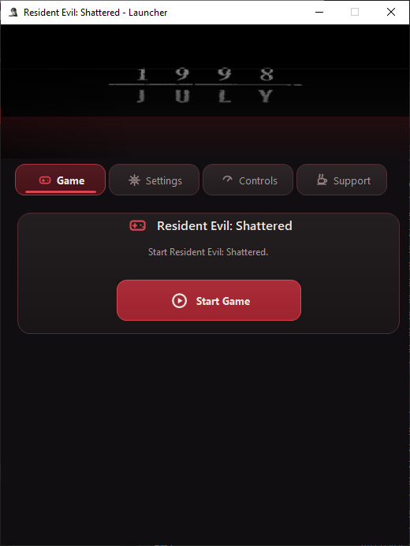
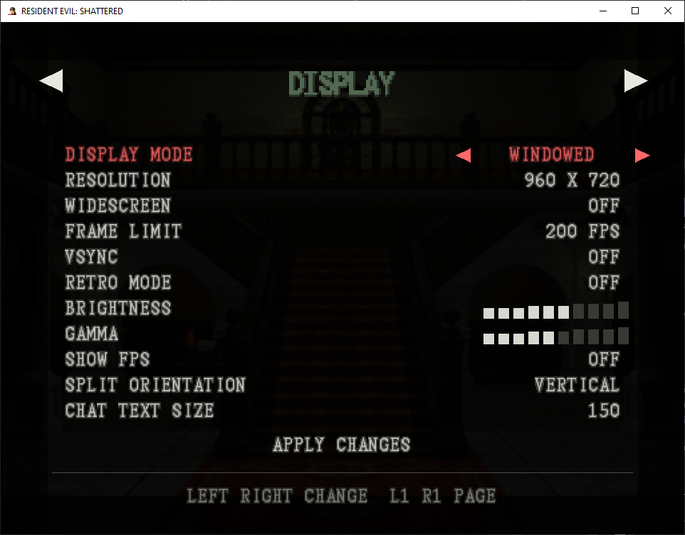
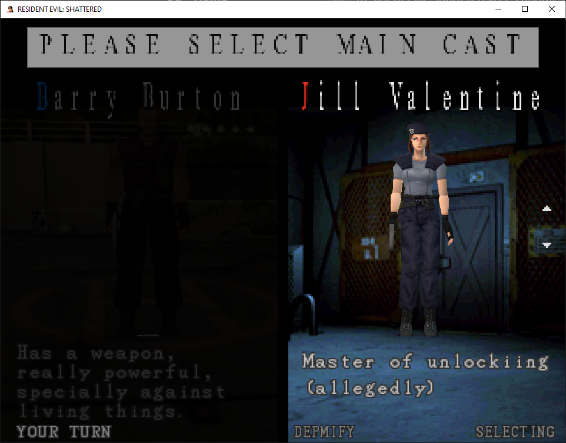
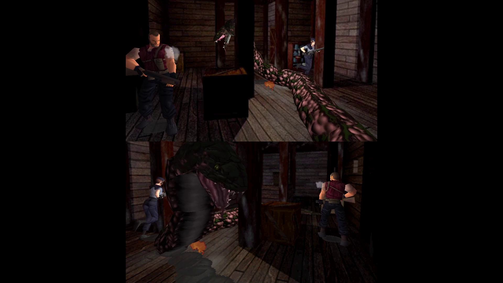

# RESIDENT EVIL: SHATTERED

**RESIDENT EVIL: SHATTERED** is a closed-source fan project that brings a new way to experience classic Resident Evil survival horror, including cooperative SplitScreen play.

This public repository is used for public releases, screenshots, installation notes, issue tracking, and community-facing documentation. The active source code, internal tools, and development assets are maintained privately.

## Screenshots

| Launcher | Game Settings | Online Character Select |
| --- | --- | --- |
|  |  |  |

  

  <strong>v0.1.7 supports any PC version of Resident Evil 1 and online sessions of up to four players.</strong> 
  Play together online or through SplitScreen.

## Project Status

SHATTERED **v0.1.7** is the latest public release.

SHATTERED now works with the GOG, Steam, and Sourcenext versions of Resident Evil 1. Essentially any existing PC version is supported. Online sessions can hold up to four players, mod features have been improved, and this update includes various fixes.

> **Three or four players is experimental.** With more than two players online, the campaign can be played up to the laboratories but cannot be completed yet. Two-player online co-op still covers the complete campaign.

## Downloads

Download **v0.1.7** from the [GitHub release page](https://github.com/Depmify/Resident-Evil-SHATTERED/releases/tag/v0.1.7).

Cooperative play is available online and through **SplitScreen**. Two-player online co-op supports the complete campaign; three- and four-player online sessions are experimental.

> No original Resident Evil game assets are included in this repository or in public releases.

## Installation

For setup instructions, supported game data, and the expected launcher folder layout, see [INSTALL.md](INSTALL.md).

## Requirements

To use SHATTERED, you must provide your own legally obtained PC copy of Resident Evil 1 (GOG, Steam, Sourcenext, or another existing PC version).

Additional requirements may vary by release and will be documented alongside each build.

## Reporting Issues

Use the **Issues** tab to report crashes, launcher problems, setup issues, compatibility problems, or behavior differences seen in the current public build.

When reporting a bug, please include:

- SHATTERED version or build
- Windows version
- PC version of the game used (GOG, Steam, Sourcenext, etc.)
- whether you launched in Solo, SplitScreen, or Online mode, and how many players were in the session
- steps to reproduce the issue
- screenshots or logs if available

## Source Code

SHATTERED is a closed-source project.

The public repository does not contain the active source code, internal research branches, private tools, or development assets. Public releases and documentation are provided for users, testers, and project tracking.

## Legal Notice

RESIDENT EVIL is a trademark of Capcom.

RESIDENT EVIL: SHATTERED is an unofficial fan project and is not affiliated with, endorsed by, sponsored by, or approved by Capcom.

This project does not distribute original game assets, copyrighted data files, or commercial game content. Users are responsible for providing their own legally obtained game data where required.

## Links

- [Installation Guide](INSTALL.md)
- [v0.1.7 Release](https://github.com/Depmify/Resident-Evil-SHATTERED/releases/tag/v0.1.7)
- [All Releases](https://github.com/Depmify/Resident-Evil-SHATTERED/releases)
- [Issues](https://github.com/Depmify/Resident-Evil-SHATTERED/issues)
